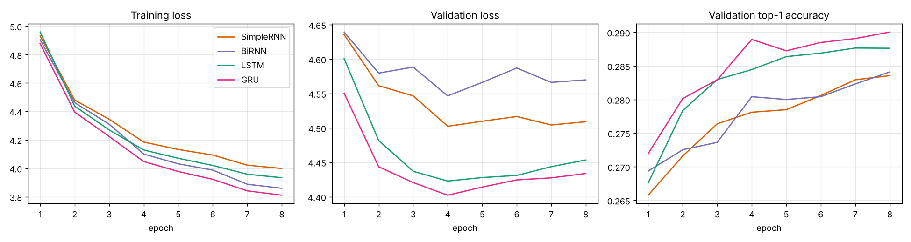
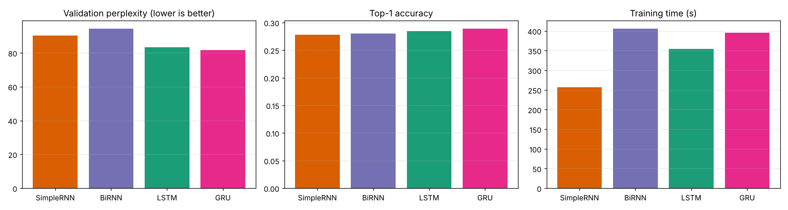
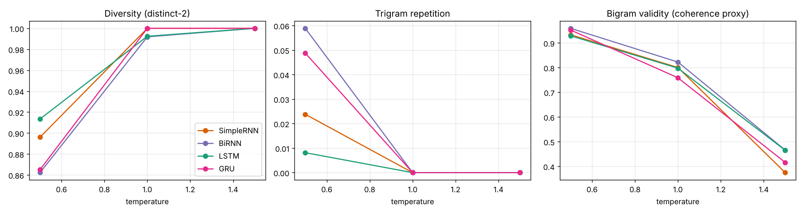

# Autoregressive word-level text generation on Tiny Shakespeare

Assignment 2 for Foundations of Generative AI (ICT4403). The project trains four recurrent models (Simple RNN, Bidirectional RNN, LSTM and GRU) to predict the next word of Shakespeare's text, then uses each model to generate new text from the same seed phrases at three sampling temperatures.

## Problem statement and objective

An autoregressive language model predicts the next word from the words before it. Feeding each predicted word back in as input lets the model write text one word at a time.

The objective is to build this system with four recurrent architectures under the same experimental conditions, and to answer two questions:

1. Which architecture predicts the next word best, judged by loss, perplexity, accuracy and training time?
2. Which architecture writes the best text, judged by coherence, diversity, contextual consistency and repetition, and how does sampling temperature change that?

## Dataset

Tiny Shakespeare is a plain text file of Shakespeare's plays, distributed with Andrej Karpathy's char-rnn repository.

- Page: https://github.com/karpathy/char-rnn/blob/master/data/tinyshakespeare/input.txt
- Direct download: https://raw.githubusercontent.com/karpathy/char-rnn/master/data/tinyshakespeare/input.txt

| Property | Value |
|---|---|
| Characters | 1,115,394 |
| Lines | 40,001 |
| Tokens after preprocessing | 290,145 |
| Unique tokens before the vocabulary cap | 12,380 |
| Vocabulary used | 5,000 (4,999 most frequent tokens plus `<unk>`) |
| Share of tokens mapped to `<unk>` | 3.2% |
| Training windows | 261,118 |
| Validation windows | 29,003 |

The text is a mix of dialogue and verse. Each speech starts with a speaker label ending in a colon (for example `first citizen:`), and lines are short. The most frequent tokens are the newline marker, comma, colon and period, followed by function words such as "the", "and", "to" and "i". Early modern vocabulary ("thou", "hath", "doth") and many character names make up the long tail.

### Preprocessing

1. Lowercase the text.
2. Split it into tokens with a regular expression: words (apostrophes kept, so "we'll" stays one token), the punctuation marks `. , ! ? ; :`, and line breaks (written `<nl>`). Keeping punctuation and line breaks lets the models learn the play format.
3. Keep the 4,999 most frequent tokens. Every other token becomes `<unk>`. The generator never samples `<unk>`.
4. Split chronologically: the first 90% of the tokens are for training and the last 10% for validation, so the validation text comes from plays the model has not seen.
5. Build input-target pairs with a sliding window of stride 1. The input is 12 consecutive tokens and the target is the token that follows. For a window starting at position `i`, `x = tokens[i : i+12]` and `y = tokens[i+12]`.

## Models

All four models share the same structure: an embedding layer (100 dimensions), dropout (0.2), one recurrent layer with 128 hidden units, dropout, and a linear layer that scores every word in the vocabulary. The output at the last time step feeds the linear layer.

| Model | Recurrent layer | Notes |
|---|---|---|
| Simple RNN | `nn.RNN` with tanh | Plain recurrence, no gates |
| BiRNN | `nn.RNN` with tanh, bidirectional | Forward and backward states are concatenated, so the output layer receives 256 values. The backward pass reads only the 12-word input window, never future words, so generation stays autoregressive. |
| LSTM | `nn.LSTM` | Input, forget and output gates plus a cell state |
| GRU | `nn.GRU` | Update and reset gates, no separate cell state |

### Comparable training conditions

| Setting | Value |
|---|---|
| Loss | Cross-entropy |
| Optimizer | Adam, learning rate 0.002, halved every 3 epochs |
| Batch size | 256 |
| Epochs | 8 |
| Gradient clipping | Norm 1.0 |
| Initialization seed | 42 for every model |
| Batch order | Identical for every model |
| Checkpoint | Weights from the epoch with the lowest validation loss |
| Hardware | 2 CPU cores, no GPU |

## Execution steps

```bash
git clone https://github.com/Akanshya1595/FGAI_AutoregressiveModel_IA
cd shakespeare-text-generation
pip install -r requirements.txt

# only needed if data/input.txt is missing
mkdir -p data
curl -L -o data/input.txt https://raw.githubusercontent.com/karpathy/char-rnn/master/data/tinyshakespeare/input.txt

python train.py
```

The full run took about 25 minutes on 2 CPU cores. Quick test: `python train.py --epochs 1 --max_train 30000 --out results_test`. The notebook `shakespeare_generation.ipynb` runs the script and displays the saved results.

Dependencies: Python 3.9 or later, `torch`, `numpy`, `matplotlib`.

Files:

```
train.py                        data preparation, models, training, evaluation, generation
shakespeare_generation.ipynb    notebook wrapper that runs the script and shows results
requirements.txt
data/input.txt                  Tiny Shakespeare
train_log.txt                   console log of the full run
results/
  metrics.json                  validation metrics, parameter counts, training times
  history.csv                   per-epoch losses and accuracies
  generation_metrics.json       text metrics per model, seed and temperature
  generation_summary.json       the same, averaged over seeds
  generated_samples.md          all generated text
  training_curves.png
  model_comparison.png
  temperature_effects.png
  *.pt                          saved weights
```

## Results

### Prediction quality on the validation set

| Model | Parameters | Val loss | Perplexity | Top-1 accuracy | Top-5 accuracy | Training time (8 epochs) |
|---|---|---|---|---|---|---|
| Simple RNN | 1,174,440 | 4.502 | 90.2 | 27.8% | 45.0% | 257 s |
| BiRNN | 1,843,880 | 4.547 | 94.3 | 28.0% | 44.9% | 406 s |
| LSTM | 1,262,760 | 4.423 | 83.3 | 28.4% | 45.8% | 355 s |
| GRU | 1,233,320 | 4.402 | 81.6 | 28.9% | 46.9% | 396 s |

Loss, perplexity and accuracy come from each model's best checkpoint, which was epoch 4 for all four. Perplexity is the exponential of the validation cross-entropy. A value of 81.6 means the GRU is as uncertain as if it were choosing among about 82 equally likely words at each step.





## Model comparison and evaluation

Quantitative results:

- GRU has the best value on every prediction metric: lowest loss and perplexity, highest top-1 and top-5 accuracy. LSTM is close behind, 1.7 perplexity points higher.
- Both gated models beat both ungated models by a clear margin. The gap between LSTM and Simple RNN is about 7 perplexity points, much larger than the gap between LSTM and GRU.
- BiRNN has the worst validation loss even though it has 57% more parameters than the Simple RNN. Its training loss ended near the GRU's, so the extra capacity mostly went into fitting the training text. A likely reason is that the backward pass over a 12-word window adds little for predicting the word that comes after the window.
- Validation loss was lowest at epoch 4 for every model and rose slightly afterwards while training loss kept falling, so all four models begin to overfit after about four epochs.
- The Simple RNN trained fastest at 32 s per epoch. The other three took 44 to 51 s per epoch. The order among BiRNN, GRU and LSTM is within what a shared 2-core machine can produce, so only the gap to the Simple RNN should be taken seriously.

Qualitative observations, based on reading the 36 generated passages in `results/generated_samples.md`:

- Every model reproduces the play format: speaker labels such as `king richard iii:` or `second citizen:` followed by a colon and a short speech.
- At low temperature all four write plausible Shakespearean phrases ("i have forgot you, for you have heard thee") but the meaning drifts from clause to clause. None keeps a topic across a full passage, which is expected from a 12-word context window.
- The BiRNN and GRU produced more repeated trigrams at low temperature than the LSTM (see the table below). The Simple RNN and LSTM occasionally repeated a word twice in a row ("and and").

## Sampling temperature analysis

Each model generated 50 words from the same three seeds at temperatures 0.5, 1.0 and 1.5. The sampling random stream was identical across models for each seed. Temperature divides the logits before the softmax: values below 1 sharpen the distribution toward likely words, values above 1 flatten it.

The text metrics, averaged over the three seeds:

- Distinct-2: share of bigrams in the passage that are unique (higher means more diverse).
- Trigram repetition: share of trigrams that repeat an earlier trigram (lower is better).
- Bigram validity: share of adjacent word pairs that appear somewhere in the training text. This is a rough coherence proxy. It checks local word order, not meaning.

| Model | Temp | Distinct-2 | Trigram repetition | Bigram validity |
|---|---|---|---|---|
| Simple RNN | 0.5 | 0.896 | 0.024 | 0.933 |
| Simple RNN | 1.0 | 1.000 | 0.000 | 0.801 |
| Simple RNN | 1.5 | 1.000 | 0.000 | 0.375 |
| BiRNN | 0.5 | 0.862 | 0.059 | 0.959 |
| BiRNN | 1.0 | 0.992 | 0.000 | 0.823 |
| BiRNN | 1.5 | 1.000 | 0.000 | 0.466 |
| LSTM | 0.5 | 0.913 | 0.008 | 0.929 |
| LSTM | 1.0 | 0.992 | 0.000 | 0.798 |
| LSTM | 1.5 | 1.000 | 0.000 | 0.465 |
| GRU | 0.5 | 0.865 | 0.049 | 0.952 |
| GRU | 1.0 | 1.000 | 0.000 | 0.759 |
| GRU | 1.5 | 1.000 | 0.000 | 0.416 |



Temperature 0.5. The text is the most locally coherent, with 93 to 96% of word pairs seen in the training data, and it reads as grammatical Shakespeare-style phrasing. It is also the most repetitive and the least diverse. Short loops appear, and common words such as "the", "of" and "to" dominate. This setting suits a reader who wants safe, fluent text and does not mind sameness.

Temperature 1.0. Repetition disappears in these samples and nearly every bigram is unique. Bigram validity drops to 76 to 82%, and the text starts mixing words that do not normally go together ("the tongueless; and when thou diest darkness"). Sentences keep a play-like shape but lose sense more often. This is the middle ground between the two extremes.

Temperature 1.5. Diversity is at its maximum and the text is mostly noise. Only 38 to 47% of word pairs appear in the training text, and the passages read as unrelated words and rare names ("lucentio bloody moody signories the commission be"). No model produces usable text here.

The three temperatures show a straightforward trade-off: raising temperature buys diversity and removes repetition, and it costs coherence at an accelerating rate. Between 1.0 and 1.5 the validity drop (33 to 43 points) is far larger than the drop between 0.5 and 1.0 (13 to 19 points). At any one temperature the four models land within a few points of each other, so temperature changes the text more than architecture does in this experiment.

## Conclusion

The GRU is the best model for this dataset. It has the lowest validation loss (4.402) and perplexity (81.6) and the highest top-1 (28.9%) and top-5 (46.9%) accuracy. Its training cost is similar to the LSTM and BiRNN, and it has fewer parameters than either the LSTM or the BiRNN. At temperature 1.0 its samples are varied and have no repeated trigrams, and at 0.5 they are the most coherent of the gated models by the bigram-validity measure. The best temperature among the three tested is 1.0 for variety or 0.5 for fluency, and a value between the two is likely a better compromise, though it was not tested.

The margin between the GRU and the LSTM is small (1.7 perplexity points) and comes from one training run per model, so the two should be treated as close competitors. The ranking of the gated models over the ungated ones is much more reliable. The BiRNN does not pay off for next-word generation here.

## Limitations

- Each model was trained once with one random seed. Differences of one or two perplexity points could change with another seed.
- Generation metrics use three seeds with 50 words each, which is a small sample. Bigram validity measures local plausibility only and says nothing about meaning.
- The context window is 12 words, so the models cannot track plot or topic across a speech.
- The vocabulary is limited to 5,000 tokens and 3.2% of the text became `<unk>`.
- Training time was measured on a shared 2-core CPU, so small timing differences are not reliable.
- Hyperparameters (hidden size, window length, epochs) were fixed in advance and not tuned per model.
